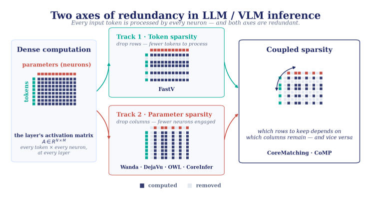

I recently worked through a chain of papers on a single problem: **reducing the inference cost of large language and vision-language models by exploiting redundancy in their computation** — identifying which input tokens and which model components can be omitted without meaningfully degrading the output. The trail ran through these papers: FastV, Wanda, DejaVu, OWL, CoreInfer, CoreMatching, and CoMP — all published in top-tier AI venues.

Read individually, each paper contributes a method. Read in sequence, they map out where this area currently stands — and reveal something none of them states outright. The field has pursued this goal along two distinct paths: one removes **input tokens** before they are processed, the other removes **model parameters** that contribute little. These were long treated as separate design choices addressing separate kinds of redundancy. The most recent work suggests they are not separate at all — that the two are coupled, and that measuring one well requires accounting for the other.

What follows is that trail, the state it has reached, and what I think it leaves unresolved.

**A note on terminology,** since these papers use overlapping vocabulary. A **token** is an element of the input sequence. A **feature** (or *input channel*) is a single dimension of a hidden-state vector — one column of the input to a linear layer. A **neuron** is a unit in the FFN's intermediate layer, whose activation is one dimension of that layer's output. The FFN intermediate dimension is both a neuron's output and an input channel to the down-projection: the same quantity viewed from either side.

## The problem: Transformers compute more than any single input needs

Transformer inference carries redundancy along two axes.

**Along the input tokens.** Vision-language models convert images into long token sequences before the language model sees them. LLaVA turns a 336×336 image into 576 tokens, and a 672×672 image into 2,304. Attention cost grows quadratically in sequence length, and every surviving token must also pass through the FFN.

**Along the model parameters.** The attention projections and FFN blocks contain enormous numbers of weights, but their contribution is far from uniform. For any particular input, only a subset of neurons, channels, or heads meaningfully affects the output.

This gives two natural questions:

**Which input tokens need to be processed?** And **which model components need to participate in processing them?**

For several years these were pursued largely separately. Let me take them in turn.

---

<figure>
  
  <figcaption>Both tracks operate on the same object: the layer's activation matrix \(A \in \mathbb{R}^{N \times M}\); token pruning removes rows; parameter pruning removes columns.</figcaption>
</figure>

The grid above is not a metaphor. It is the activation matrix $$A \in \mathbb{R}^{N \times M}$$ produced at a linear layer, where $$A[n,m]$$ is the activation of neuron $$m$$ for token $$n$$. In the FFN specifically, $$A = \sigma(X \cdot W_{\text{up}})$$. Redundancy along the token axis only exists once tokens are present, so the object both tracks operate on has to be an activation matrix rather than a weight matrix — $$W$$ is identical for every input and has no token dimension at all.

## Track 1: Reduce the input tokens

### FastV — attention as a token importance score

**FastV** (Liang Chen et al., ECCV 2024) begins with a measurement rather than a method. Examining LLaVA-1.5 on captioning tasks, the authors found that image tokens receive an average attention score of only **0.21%** of that received by system prompt tokens in layers after the second — while in the first two layers that figure is roughly **50%**.

Their explanation: in shallow layers, self-attention aggregates image-related information onto a small number of **"anchor" tokens**, which are notably *not* image tokens. Deeper layers then attend primarily to those anchors, leaving the original image tokens largely bypassed.

From this, FastV introduces an **attention-based token importance score**: after a chosen layer, each image token is ranked by the average attention it receives, and tokens below a threshold are discarded for all subsequent layers. Because tokens are removed from the sequence entirely, the saving applies to both self-attention and the FFN — not only to attention, as sparse-attention methods do.

On LLaVA-1.5-13B, pruning 50% of image tokens after layer 2 preserves average performance across captioning, multiple-choice VQA, embodied reasoning, OCR, and video QA, yielding roughly **45% FLOPs reduction**. In their latency experiment, a 13B model with FastV runs faster than a dense 7B model while performing better.

The paper positions itself as the first to explore visual token reduction specifically for LVLMs, using signals from the language model to decide which visual tokens survive. That framing proved influential: subsequent work has scored token importance via attention, feature similarity, and diversity criteria, applied at single or multiple layers, sometimes with fine-tuning to recover performance.

But FastV's own finding raises a question it does not settle: **is received attention a reliable measure of a token's importance?** That question returns later.

## Track 2: Reduce the model computation

Two genuinely different problems live under this heading, and separating them clarifies the literature considerably.

### DejaVu — sparsity that depends on the input

**DejaVu** (Zichang Liu et al., ICML 2023) asks whether the useful subset of a model's *parameters* changes from input to input.

The verification is elegantly simple. Run two forward passes: in the first, record which attention heads and FFN neurons produce large output norms for this input; in the second, compute using only that recorded subset. On OPT-175B, 66B, and 30B, the two passes produce essentially the same predictions.

The magnitudes are striking — roughly **80% of attention heads** and **95% of FFN neurons** can be skipped for a given token, about **85% total structured sparsity**, implying up to a 7× potential parameter reduction per input.

The authors call this **contextual sparsity**, and the distinction from prior work is fundamental:

> **Static sparsity:** "This component is globally unnecessary."
>
> **Contextual sparsity:** "This component is unnecessary *for this input*."

Two findings make it exploitable. First, sparsity depends not only on individual tokens but on their *interactions* — predictions from token identity alone are inaccurate, while predictions from contextualized embeddings are not. Second, because residual connections make token embeddings change slowly across layers, the input to layer $$k$$ is a good predictor of what layer $$k+1$$ will need.

That second observation enables the system's key engineering move: **asynchronous lookahead predictors**. The input to block $$k$$'s attention is used to predict sparsity for block $$k$$'s FFN, and the FFN input predicts the next block's attention heads — so prediction latency hides behind computation rather than adding to it. The overhead constraint is severe: one FFN block on OPT-175B takes only 0.2 ms on an 8×A100 machine, so a slow predictor would cost more than it saves.

With hardware-aware sparse matrix multiplication, DejaVu reduces OPT-175B latency by over **2×** versus NVIDIA's FasterTransformer.

### Wanda — importance as weight × input activation

**Wanda** (Mingjie Sun et al., ICLR 2024) addresses a different problem: permanent one-shot compression, with no retraining and no weight updates.

Its motivation is a phenomenon specific to large models. Beyond roughly 6B parameters, LLMs develop **emergent large-magnitude features** — a small set of hidden-state dimensions whose values run about 100× larger than typical. They are sparse, concentrated in particular dimensions, and essential: zeroing them at inference severely degrades performance.

Standard magnitude pruning is blind to this. Consider a neuron computing $$y = w_1 x_1 + w_2 x_2$$ with $$\lvert w_1 \rvert \le \lvert w_2 \rvert$$. Magnitude pruning always removes $$w_1$$. But if $$\lvert x_1 \rvert \gg \lvert x_2 \rvert$$, then $$\lvert w_1 x_1 \rvert \gg \lvert w_2 x_2 \rvert$$, and removing $$w_2$$ would perturb the output far less.

Wanda's fix is one line — score each weight by its magnitude times the L2 norm of its corresponding input channel, aggregated across calibration tokens:

$$
S(W_{ij}) = \lvert W_{ij} \rvert \times \lVert X_j \rVert_2
$$

A second design choice matters as much: weights are compared **per output** (within each row of the weight matrix) rather than globally across the layer. The authors find this local grouping crucial for LLMs.

The method needs a single forward pass, minimal memory, and no access to original training data — competing with SparseGPT's Hessian-based reconstruction at far lower cost.

The lasting lesson is broader than the formula. **What determines a weight's effect on the output is not the size of the weight but the size of the product it produces.** A small weight multiplied by a large input contributes more to the output than a large weight multiplied by a near-zero input. Magnitude pruning scores the weight alone; Wanda scores the product — which is what actually shows up downstream.

### OWL — how much to prune per layer

**OWL** (Lu Yin et al., ICML 2024) questions an assumption inherited from BERT-era pruning: that every layer should receive the same sparsity ratio.

The authors first observe that effective pruning methods preserve the same emergent large-magnitude features Wanda exploits — which OWL refers to as **outliers**. SparseGPT preserves them too, even though it was not designed with that intent. The authors then find that these outliers are distributed **non-uniformly across depth**, and formalize this as a **Layerwise Outlier Distribution (LOD)**, used to set each layer's sparsity ratio in proportion to its outlier prevalence.

This cleanly separates two decisions that had been conflated:

1. **Which weights to remove within a layer** (Wanda, SparseGPT)
2. **How much sparsity each layer should receive** (OWL)

At aggressive sparsity, the second turns out to matter enormously. For LLaMA-7B at 70% sparsity, OWL improves perplexity over Wanda by **61.22**; at 80% the gap exceeds 3,300. The gain grows as models get smaller, and OWL delivers **2.6×–3.9×** end-to-end speedup on CPUs in DeepSparse at 70–90% sparsity.

### CoreInfer — making contextual sparsity executable

Contextual sparsity creates a systems problem. If the set of active neurons changes with every generated token, the system must repeatedly select and load different rows of the weight matrices from memory — irregular, unpredictable access that can cost more than the arithmetic it saves. Predictor-based methods add further overhead: an MLP predictor per activation layer can introduce roughly **10%** additional computation.

**CoreInfer** (Qinsi Wang et al., 2024) asks whether the active set can be held fixed at a coarser granularity. It defines **token-wise core neurons** — the top-$$\alpha$$ of a token's positively-activated FFN neurons — then **sentence-wise core neurons** as the top-$$\beta$$ of neurons appearing most frequently across all tokens in the sentence.

Note how this differs from OWL's outliers, despite both concerning "important units." Outliers are hidden-state *dimensions* that carry unusually large magnitude across inputs generally — a fairly static property of the trained model. Core neurons are FFN units that a *particular* input activates strongly — an input-dependent property. One is about the model; the other is about the interaction between model and input.

The empirical finding that makes CoreInfer work: tokens within the same sentence activate strongly overlapping neuron sets, while tokens from different sentences form separate clusters. **Which neurons a token needs is largely determined by the meaning of the sentence it belongs to**, so one fixed set can serve an entire sentence. On C4, perplexity rises only about 2% relative to the dense model at $$\alpha = 0.4$$, and about 3% at $$\beta = 0.25$$.

This permits a clean design: determine core neurons once during prefill, hold them fixed through decoding, and use **no MLP predictors at all** — hence "zero-cost" sparse inference during generation. Because the active set no longer changes per token, the required weights are loaded once and reused for every decode step. On an NVIDIA TITAN XP, CoreInfer reports **10.33×** speedup over the HuggingFace implementation and **2.72×** over PowerInfer.

The conceptual shift is worth naming: the field moves from *finding* sparsity to asking whether a sparsity pattern **stays fixed long enough to be worth exploiting on real hardware.**

It is also worth noticing how close this brings the two tracks. CoreInfer's core neurons are columns of the FFN's intermediate activation matrix — and that same matrix is the *input* to the down-projection, which is exactly the $$X$$ whose column norms Wanda scores. Wanda takes the L2 norm of each column; CoreInfer counts how many entries in each column clear a threshold. Two methods from two different literatures, two different reductions — computed over the same matrix. The convergence that follows was, in this sense, already latent in the arithmetic.

## The convergence: tokens and parameters may not be independent

### CoreMatching — neurons reveal tokens

**CoreMatching** (Qinsi Wang et al., ICML 2025) takes CoreInfer's core-neuron machinery into VLMs and then reverses its direction.

The insight: for each token, count how many of its activated neurons fall inside the sentence-level core-neuron set. Tokens with the largest overlap turn out to be precisely the prompt-relevant ones. **The FFN's own activation pattern reveals which image regions matter** — no separate scoring head, no attention heuristic, no training.

CoreMatching also supplies a theoretical critique of attention-based scoring that deserves wider attention. Since the attention output is a weighted sum of value vectors, a token's actual contribution depends on three quantities: the attention coefficient, the **magnitude of its value vector**, and the **angular alignment** of that contribution with the output direction. Attention magnitude captures only the first — a token can be heavily attended yet contribute little if its value vector points away from where the output actually goes.

The resulting system prunes tokens and neurons jointly from a single prefill pass, reporting **5× FLOPs reduction and 10× overall speedup** on an NVIDIA Titan Xp.

### CoMP — making parameter importance token-aware

**CoMP** (Zimeng Wu et al., CVPR 2026) attacks the coupling from the other direction, and grounds it in a sharp diagnostic.

Recall that the two tracks use different scoring functions. A **parameter importance metric** — Wanda-style — aggregates input activations across many tokens to score each weight. A **token importance metric** — FastV-style — scores each token by the attention it receives. CoMP's authors asked how well these two agree, and measured it directly on BLIP's vision encoder.

The answer is that they disagree substantially. At layer 10, the tokens contributing most to the parameter-importance computation overlap **less than 30%** with the tokens ranked highest by the token-importance metric — meaning tokens the model considers unimportant were nonetheless dominating the estimate of which parameters to keep. Running the check in reverse at layer 2, **75% of the parameters ranked least important still substantially influenced token-importance scores** — meaning tokens were being scored partly on the basis of parameters that were about to be removed.

Each metric, in short, was being computed using inputs the other metric had already judged worthless.

Their **Collaborative Importance Metric** addresses both directions. For parameters, it extends Wanda's score with a token-importance weighting term, so that the tokens flowing into a parameter no longer count equally toward its score — important tokens contribute more. For tokens, it transfers the parameter pruning mask onto the attention weight matrix, suppressing the contribution of heads that are about to be pruned anyway.

CoMP's second contribution concerns *what* to prune at each point in the process. A **pruning mode** is a specific choice of target: vision parameters, language parameters, cross-modal parameters, vision tokens, or language tokens. Most progressive-pruning methods fix the order of these modes in advance. CoMP shows that the best mode shifts as the model changes over the course of pruning, making a fixed order suboptimal. Their **Multi-Mode Pruning Strategy** therefore decomposes pruning into stages and, at each one, estimates the cost of every available mode and shifts to the cheapest — using historical cost and random exploration to stay stable and avoid locally optimal choices.

The conceptual progression across the whole trail:

**parameter magnitude → weight × activation → contextual sparsity → semantic stability → non-uniform layer budgets → token–neuron co-adaptation → collaborative multi-mode pruning.**

## What looks settled — and what does not

Three principles now seem well supported.

**Uniform computation is a poor default.** Importance varies across weights, neurons, layers, tokens, modalities, inputs, and inference stages. Nearly every advance in this trail came from questioning a uniformity assumption someone had inherited rather than justified.

**The importance metric matters as much as the pruning ratio.** Magnitude alone misses activation statistics. Attention alone misses value-vector geometry. Uniform layer budgets miss differences in outlier prevalence. Uniform token weighting misses which tokens actually drive a parameter.

**Algorithmic FLOPs are only half the story.** A sparse method becomes an inference method only when its pattern maps onto real memory movement and hardware. DejaVu's 0.2 ms constraint, CoreInfer's avoidance of predictor overhead, and OWL's DeepSparse measurements all reflect this. Unstructured sparsity that reduces FLOPs on paper without reducing wall-clock time is a known trap — DejaVu notes that SparseGPT's 60% unstructured sparsity yielded no speedup at the time.

Several questions remain open.

**Attention remains an attractive but imperfect token-importance signal.** CoreMatching offers a geometric argument for why. Empirically, *Feather the Throttle* (Endo et al., ICCV 2025), a study revisiting visual token pruning, shows that early attention-based pruning introduces strong spatial biases and degrades localization severely — even while conventional VQA benchmarks stay nearly flat. "Near-lossless" is only as meaningful as what the benchmark measures. Notably, CoMP's token metric remains attention-based despite CoMP's own evidence of metric mismatch.

**Joint importance is still estimated in a single pass.** If token relevance shapes parameter importance and parameter activations reveal token relevance, then the two quantities are defined partly in terms of each other. Every method here resolves that circularity by computing one from a *fixed* estimate of the other — Wanda from uniform token weights, CoreMatching from a frequency count, CoMP from attention scores. Whether treating it as a genuinely coupled system yields a materially different answer seems, to me, an open question.

**Dynamic sparsity must justify its own overhead.** DejaVu's asynchronous predictor and CoreInfer's predictor-free design are both responses to this constraint. Prediction latency, the cost of building index structures, irregular memory access, and whether the resulting sparse operations actually map onto efficient GPU implementations all belong inside the objective, not in a footnote.

**Evaluation should stress what pruning is most likely to break**: fine spatial grounding, OCR, small objects, long contexts, multi-image reasoning, long generations, and distribution shift — not only aggregate scores on benchmarks tolerant of coarse visual information.

## The main takeaway

Reading these together, the shift I see is this:

**The field is moving from "find redundant components" toward "understand the structure and interaction of redundancy."**

The interesting object is no longer the smallest weight, the weakest neuron, or the lowest-attention token in isolation. It is the relationship among **input semantics, token relevance, activation patterns, layer depth, inference stage, and hardware cost**.

That makes efficient inference an unusually rich problem — sitting at the intersection of model interpretation, optimization, multimodal reasoning, and systems design.

---

*If you are entering this area, I would suggest reading them in the order I did: FastV → Wanda → DejaVu → OWL → CoreInfer → CoreMatching → CoMP. Each becomes easier to appreciate once you have the previous.*

My current research focuses on how token and parameter importance interact in vision-language inference. If you work on sparsity, efficient LLM/VLM inference, or multimodal compression, I would be glad to exchange notes — especially on where you think the next bottleneck or unexamined assumption lies.

---

### References
{: .no_toc}

[1] Chen, Zhao, Liu, Bai, Lin, Zhou, Chang. *An Image is Worth 1/2 Tokens After Layer 2: Plug-and-Play Inference Acceleration for Large Vision-Language Models.* ECCV 2024. [arXiv:2403.06764](https://arxiv.org/abs/2403.06764)

[2] Sun, Liu, Bair, Kolter. *A Simple and Effective Pruning Approach for Large Language Models.* ICLR 2024. [arXiv:2306.11695](https://arxiv.org/abs/2306.11695)

[3] Liu, Wang, Dao, Zhou, Yuan, Song, Shrivastava, Zhang, Tian, Ré, Chen. *Deja Vu: Contextual Sparsity for Efficient LLMs at Inference Time.* ICML 2023. [arXiv:2310.17157](https://arxiv.org/abs/2310.17157)

[4] Yin, Wu, Zhang, Hsieh, Wang, Jia, Pechenizkiy, Liang, Wang, Liu. *Outlier Weighed Layerwise Sparsity (OWL): A Missing Secret Sauce for Pruning LLMs to High Sparsity.* ICML 2024. [arXiv:2310.05175](https://arxiv.org/abs/2310.05175)

[5] Wang, Vahidian, Ye, Gu, Zhang, Chen. *CoreInfer: Accelerating Large Language Model Inference with Semantics-Inspired Adaptive Sparse Activation.* 2024. [arXiv:2410.18311](https://arxiv.org/abs/2410.18311)

[6] Wang, Ye, Chung, Liu, Lin, Kuo, Ma, Zhang, Chen. *CoreMatching: A Co-adaptive Sparse Inference Framework with Token and Neuron Pruning for Comprehensive Acceleration of Vision-Language Models.* ICML 2025. [arXiv:2505.19235](https://arxiv.org/abs/2505.19235)

[7] Wu, Wang, Wang, Chen. *Collaborative Multi-Mode Pruning for Vision-Language Models.* CVPR 2026. [arXiv:2604.02956](https://arxiv.org/abs/2604.02956)

[8] Frantar, Alistarh. *SparseGPT: Massive Language Models Can Be Accurately Pruned in One-Shot.* ICML 2023. [arXiv:2301.00774](https://arxiv.org/abs/2301.00774)

[9] Endo, Fu, Xu, et al. *Feather the Throttle: Revisiting Visual Token Pruning for Vision-Language Model Acceleration.* ICCV 2025. [arXiv:2412.13180](https://arxiv.org/abs/2412.13180)

